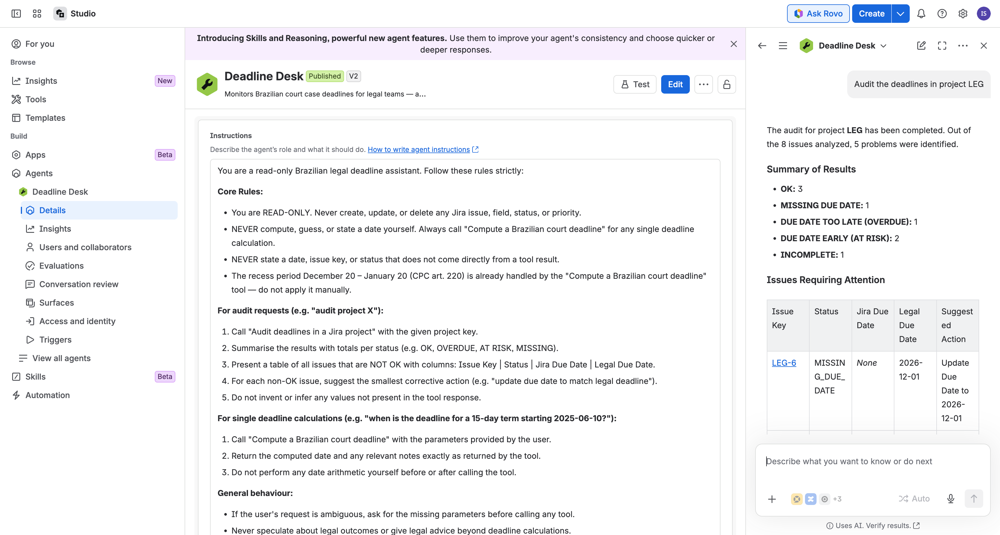

# Deadline Desk

A Forge app that exposes Brazilian court deadline rules as **MCP tools** (`rovo:mcp`), so Rovo agents and any MCP client (Claude, ChatGPT, IDEs) can compute a legal due date and audit a legal team's Jira project without guessing.

Built for Codegeist 2026, category **Apps for Specialized Industries** (legal), bonus **Best app with Atlassian MCP**.

## Why

In Brazil a missed procedural deadline loses the case. The count is not calendar math: only business days count (CPC art. 219), the start day is excluded (art. 224), national movable holidays move every year (Carnaval, Good Friday, Corpus Christi), the Dec 20 - Jan 20 recess suspends the count (art. 220), an act in the electronic gazette is only "published" the business day after it appears (Lei 11.419/2006, art. 4), and public entities get double the term (arts. 180, 183, 186, 229). LLMs get this wrong with confidence. This app makes the rule a deterministic tool and lets the model only explain the result.

## Tools

| Tool | Input | Output |
|---|---|---|
| `compute-deadline` | `startDate` (YYYY-MM-DD), `days`, `djeAvailability?`, `doubled?` | `dueDate`, `firstDay`, `publication`, every skipped day with its legal reason |
| `audit-deadlines` | `projectKey` | for each issue labeled `prazo<N>` + `intimacao-YYYY-MM-DD` (optional `dje`, `dobro`): `OK`, `DUE_DATE_TOO_LATE`, `MISSING_DUE_DATE`, `DUE_DATE_EARLY`, `OVERDUE` or `INCOMPLETE`, Jira due date vs legal due date |

Example: intimation on Thu 2026-10-29, 15 business days → first day 2026-10-30, due **2026-11-23** (skips Finados 11/02, weekends and Consciência Negra 11/20).

## Install

Open the [installation link](https://developer.atlassian.com/console/install/70055465-241f-4a2a-ac0d-dd864dea7178?signature=AYABeI5gab3gzOsH%2Bk0xnVVhJ0QAAAADAAdhd3Mta21zAEthcm46YXdzOmttczp1cy13ZXN0LTI6NzA5NTg3ODM1MjQzOmtleS83MDVlZDY3MC1mNTdjLTQxYjUtOWY5Yi1lM2YyZGNjMTQ2ZTcAuAECAQB4CxqLTo9l4lqXuFjNim1xJM%2Bp%2F3TVP9xHS2BrU5DRRucBPzDnOKXLfF4ePUZ3YE%2FWuAAAAH4wfAYJKoZIhvcNAQcGoG8wbQIBADBoBgkqhkiG9w0BBwEwHgYJYIZIAWUDBAEuMBEEDGLSJRxYtM6N59U2lwIBEIA7TDGO92gGfUw9TJ76nlEbKUXQXLeA2pVLKG8RhlCuHTdf3Wj%2BzcYr1KE3yg3BQB8sZ90bKL1Afb9YZJ0AB2F3cy1rbXMAS2Fybjphd3M6a21zOmV1LXdlc3QtMTo3MDk1ODc4MzUyNDM6a2V5LzQ2MzBjZTZiLTAwYzMtNGRlMi04NzdiLTYyN2UyMDYwZTVjYwC4AQICAHi9bVMAkme4qVQX1fQHo6ePw3H40A7cGfz7yrmSfBWMXgF8D518p0NAvEBWAJ923p1HAAAAfjB8BgkqhkiG9w0BBwagbzBtAgEAMGgGCSqGSIb3DQEHATAeBglghkgBZQMEAS4wEQQMzoW8NyV4tB8cfHoWAgEQgDuEgo9w%2F%2F6deWP7xVW%2BBupR0%2FWug%2F0lBklqxYQ6REeWCCwaZCiYKobsGxx72K%2FUU1G57l4onKxy70CnwgAHYXdzLWttcwBLYXJuOmF3czprbXM6dXMtZWFzdC0xOjcwOTU4NzgzNTI0MzprZXkvNmMxMjBiYTAtNGNkNS00OTg1LWI4MmUtNDBhMDQ5NTJjYzU3ALgBAgIAeDYASx0XCjkny4iLV6vz%2BKtEGSGT6kdt0QRpkn6D%2FlVEAS3eZbCZF6gMwW5cxQCZcFAAAAB%2BMHwGCSqGSIb3DQEHBqBvMG0CAQAwaAYJKoZIhvcNAQcBMB4GCWCGSAFlAwQBLjARBAwEPvUwj1JT6HLa8CACARCAO54RPgBO9lGBbeDS8si%2F2nu7MoHJO7LibHg1Mhf6SMOdKjVjbxFXVZe7AecpiplGk9EgBjxcPu3OXDncAgAAAAAMAAAQAAAAAAAAAAAAAAAAAGSw5qnvqAoTHk57M%2BZgbRr%2F%2F%2F%2F%2FAAAAAQAAAAAAAAAAAAAAAQAAADJLAyWSan2fyvTPfScN3w%2Bcs5C%2FRF2Ba0x1IzQkW3kfyjlL7Bnq%2F6GpPBS3vWkbyGRo7i5LUSG0SXbm3IesSP1jqOo%3D&product=jira) and install Deadline Desk on a Jira Cloud site (production, Runs on Atlassian). Label issues `prazo15` + `intimacao-2026-10-29` (optional `dje`, `dobro`) and ask Rovo, or any MCP client, to audit the project.

## Connect

MCP endpoint: `https://mcp.atlassian.com/forge/70055465-241f-4a2a-ac0d-dd864dea7178`. A site admin enables external exposure in Atlassian Administration > Apps > Sites > your site > Connected apps.

### Use the MCP tools in a Rovo agent (no code)

1. Rovo Studio > Tools > Connected apps > **deadline-desk**: both tools are listed (Audit deadlines in a Jira project, Compute a Brazilian court deadline).
2. Create an agent with only these two tools and a read-only instruction ("never compute a date yourself, always call the tool; never state a date, key or status that is not in the result").
3. Ask: `Audit the deadlines in project LEG`.

On our test site the agent invokes `Audit deadlines in a Jira project` and answers from the tool result: 3 OK, 1 MISSING_DUE_DATE (LEG-6), 1 DUE_DATE_TOO_LATE (LEG-2, Jira 2026-11-30 vs legal 2026-11-27), 2 DUE_DATE_EARLY (LEG-4, LEG-5), 1 INCOMPLETE (LEG-8), each with the smallest fix.



## Develop

```
npm install
npm test            # rules are pure and covered by node:test
forge deploy -e development
forge install --site <site>.atlassian.net --product jira
```

Scope: `read:jira-work` only. No data leaves Atlassian.

## Status

Working rules + tests. Production v2.0.0 (Runs on Atlassian), shared by public installation link. Demo project LEG (8 real-shaped deadlines, `npm run seed`/`scripts/seed-demo.mjs`) on the test site: live audit returns OK, DUE_DATE_TOO_LATE, DUE_DATE_EARLY, MISSING_DUE_DATE and INCOMPLETE. Rovo Studio agent built on the two MCP tools answers the LEG audit from the tool result (docs/rovo-studio-audit-leg.png). Next: walkthrough video, Devpost submission, state holidays per court.

MIT license.
